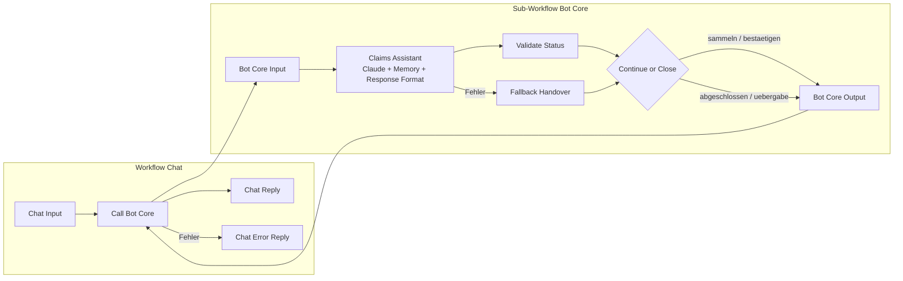

# Schadenmeldungs-Bot

Chatbot-Prototyp in **n8n**, der eine Glasbruch-Schadenmeldung (Hausrat) im Dialog aufnimmt, die Angaben
bestätigen lässt und alles Heikle mit einer strukturierten Zusammenfassung an einen Menschen übergibt.
Der Bot entscheidet nie über Deckung oder Leistung.

> **Hinweis:** Privates Lernprojekt, kein Produktivbetrieb. Die «Muster Versicherung» und alle Daten sind
> erfunden.

## Was der Bot macht

**Erfasst sechs Pflichtangaben (Slots):** Policennummer, Schadendatum, Objekt (Fenster, Glaskeramik-Kochfeld,
Spiegel, andere), Ursache, Fotos vorhanden, Rückruf-Telefon.

**Übergibt an einen Menschen**, wenn der Kunde es verlangt, Einbruch, Diebstahl oder Verletzte erwähnt
werden, der Kunde sich beschwert, ein Notfall vorliegt oder eine Angabe nach zwei Rückfragen unklar bleibt.

**Guardrails auf drei Ebenen**

| Ebene | Umsetzung |
|---|---|
| Prompt | klare Rolle, Verbote (keine Aussagen zu Deckung, Zahlung, Fristen; nichts erfinden; keine Umprogrammierung) |
| Struktur | Antwort nur als JSON nach festem Schema, Routing im Workflow statt im LLM |
| Code | erlaubte Status-Werte im Code-Node geprüft, im Zweifel Übergabe; Fallback bei technischen Fehlern |

## Architektur



- **Chat** ist nur der Kanal. Die Logik steckt im Sub-Workflow **Bot Core**, damit ihn später auch ein
  Kunden-Simulator für die Evaluation aufrufen kann.
- **Bot Core** hat genau einen Ein- und einen Ausgang: rein `sessionId` und `chatInput`, raus immer
  `antwort`, `status`, `slots`, `uebergabe_grund`.
- **Zwei Sicherheitsnetze:** Fallback Handover fängt Fehler im LLM-Aufruf ab (Parser, API, Token-Limit),
  Chat Error Reply alles andere. Der Kunde sieht nie eine technische Fehlermeldung.

## Status und Roadmap

| Bereich | Stand |
|---|---|
| Bot-Kern mit System-Prompt v1, JSON-Ausgabe, Status-Prüfung, Fallback | ✅ läuft, von Hand getestet inkl. Fehlerpfade |
| Chat-Kanal mit Fehlerbehandlung | ✅ läuft |
| Übergabe-Webhook (strukturiertes JSON an das Contact Center) | 🟡 als Nächstes |
| PII-Maskierung (Telefon, IBAN) vor dem LLM, Demaskierung vor der Übergabe | ⚪ geplant |
| Evaluation: Testfälle, LLM-as-a-Judge, Vergleich Prompt v1 gegen v2 | ⚪ geplant |

**Später:** Gesprächsverlauf in einer Datenbank statt im Arbeitsspeicher · Inhaltsprüfung der Slots
(Policennummer-Format, Datum nicht in der Zukunft) · weitere Schadenarten über einen Intent Router ·
Modellvergleich Haiku gegen Sonnet · Voice.

## Learnings

- **Das Format gehört an genau eine Stelle.** Prompt und Parser gaben verschiedene Typen für leere Felder vor
  (`null` gegen Text), jede zweite Antwort scheiterte. Seit das Format nur im Parser steht, läuft es.
  Details in [ADR 0002](docs/adr/0002-structured-json-output.md).
- **Ein Schema sichert die Form, nicht den Inhalt.** Als der Parser testweise eine Zahl erwartete, machte das
  Modell aus `HR-123456` stillschweigend `123456`. Inhalte müssen separat geprüft werden.
- **Der Fallback ist kein Theoriefall.** In rund einem Dutzend Testnachrichten lieferte das Modell zweimal
  zufällig ein kaputtes Format. Die Fehlerquote wird in der Evaluation gemessen.
- **Hilfsbereite Erfindungen.** Prompt v1 verspricht ungefragt «Ein Mitarbeiter wird sich melden» und
  übernimmt «gestern» als Datum. Beides sind Testfälle für Prompt v2.

## Setup

Voraussetzungen: Docker, ein Anthropic-API-Key.

```bash
docker compose up -d
```

1. n8n öffnen: http://localhost:5679 und ein lokales Owner-Konto anlegen.
2. Credential **Anthropic** anlegen (API-Key nur dort eingeben, nie in Dateien).
3. `workflows/bot-core.json` und danach `workflows/chat.json` importieren.
4. Im Bot Core beim Node **Claude Model** die eigene Credential auswählen.
5. Im Chat beim Node **Call Bot Core** den importierten Bot Core neu auswählen (die Workflow-ID ändert sich
   beim Import).
6. Im Workflow Chat auf **Open chat** klicken.

## Repo-Struktur

| Ordner | Inhalt |
|---|---|
| `prompts/` | System-Prompts |
| `workflows/` | exportierte n8n-Workflows (ohne Credentials) |
| `code-nodes/` | JavaScript der Code-Nodes |
| `docs/adr/` | Architekturentscheidungen |
