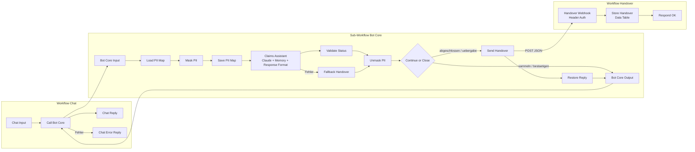
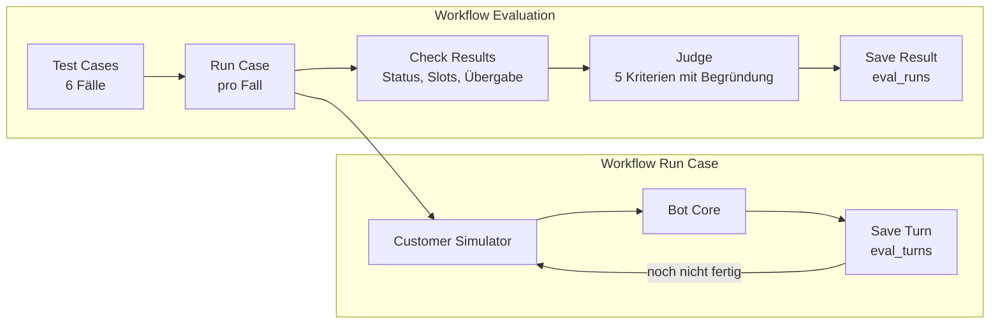

# Schadenmeldungs-Bot

Chatbot-Prototyp in **n8n**, der eine Glasbruch-Schadenmeldung (Hausrat) im Dialog aufnimmt, die Angaben
bestätigen lässt und alles Heikle mit einer strukturierten Zusammenfassung an einen Menschen übergibt.
Der Bot entscheidet nie über Deckung oder Leistung.

> **Hinweis:** Privates Lernprojekt, kein Produktivbetrieb. Die «Muster Versicherung» und alle Daten sind
> erfunden.

## Was der Bot macht

**Erfasst sechs Pflichtangaben (Slots):** Policennummer, Schadendatum, Objekt (Fenster, Glaskeramik-Kochfeld,
Spiegel, andere), Ursache, Fotos vorhanden, Rückruf-Telefon.

**Übergibt an einen Menschen**, wenn der Kunde es verlangt, Einbruch, Diebstahl oder Verletzte erwähnt
werden, der Kunde sich beschwert, ein Notfall vorliegt oder eine Angabe nach zwei Rückfragen unklar bleibt.

**Guardrails auf drei Ebenen**

| Ebene | Umsetzung |
|---|---|
| Prompt | klare Rolle, Verbote (keine Aussagen zu Deckung, Zahlung, Fristen; nichts erfinden; keine Umprogrammierung) |
| Struktur | Antwort nur als JSON nach festem Schema, kaputtes Format wird automatisch korrigiert, Routing im Workflow statt im LLM |
| Code | erlaubte Status-Werte und Pflichtangaben vor `abgeschlossen` im Code-Node geprüft, im Zweifel Übergabe; Fallback bei technischen Fehlern |
| Daten | Telefonnummer und IBAN vor dem LLM durch Platzhalter ersetzt, Originale erst nach dem LLM wieder eingesetzt |

## Architektur



**Evaluation** ([ADR 0005](docs/adr/0005-evaluation.md)): Ein Kunden-Simulator spielt jeden Testfall gegen den
unveränderten Bot Core durch. Danach prüft Code, was sich exakt prüfen lässt, und ein Judge-Modell den Rest.



- **Chat** ist nur der Kanal. Die Logik steckt im Sub-Workflow **Bot Core**, damit ihn später auch ein
  Kunden-Simulator für die Evaluation aufrufen kann.
- **Bot Core** hat genau einen Ein- und einen Ausgang: rein `sessionId` und `chatInput`, raus immer
  `antwort`, `status`, `slots`, `uebergabe_grund`, nach einer Übergabe zusätzlich `uebergabe_gesendet`.
- **PII-Maskierung:** Das LLM sieht `[TEL_1]` statt der Nummer. Das Mapping wird pro Session in einer Data Table
  gespeichert, weil die Nummer oft Nachrichten vor der Übergabe fällt ([ADR 0004](docs/adr/0004-pii-masking.md)).
- **Handover** steht für das Contact Center. Bei `abgeschlossen` und `uebergabe` schickt der Bot Core die
  Slots als JSON an diesen Webhook, der sie in einer Data Table speichert
  ([ADR 0003](docs/adr/0003-handover-webhook.md)).
- **Drei Sicherheitsnetze:** Fallback Handover fängt Fehler im LLM-Aufruf ab (Parser, API, Token-Limit),
  Restore Reply eine gescheiterte Übergabe, Chat Error Reply alles andere. Der Kunde sieht nie eine technische
  Fehlermeldung, bekommt aber auch keine Zusage, die nicht eingehalten wurde.

## Status und Roadmap

| Bereich | Stand |
|---|---|
| Bot-Kern mit System-Prompt v1, JSON-Ausgabe, Status-Prüfung, Fallback | ✅ läuft, 5 Dialog- und 4 Fehlerpfad-Tests ([Protokoll](tests/handtests-prompt-v1.md)) |
| Chat-Kanal mit Fehlerbehandlung | ✅ läuft |
| Übergabe-Webhook mit Header Auth, Speicherung in einer Data Table | ✅ läuft, 3 Webhook- und 3 Übergabe-Tests ([Protokoll](tests/handtests-handover.md)) |
| PII-Maskierung (Telefon, IBAN) vor dem LLM, Demaskierung für Kunde und Übergabe | ✅ läuft, 17 automatische und 3 Chat-Tests ([Protokoll](tests/handtests-pii.md)) |
| Evaluation: 6 Testfälle mit Kunden-Simulator, Prüfung in Code, LLM-as-a-Judge | ✅ Lauf v1 ([Ergebnis](tests/eval-v1.md), [ADR 0005](docs/adr/0005-evaluation.md)) |
| Kalibrierung des Judge, Prompt v2, Lauf v2 im Vergleich | 🔜 nächster Schritt |

**Ergebnis Lauf v1:** Endstatus 6/6 und Übergabe 6/6 richtig, die Prompt Injection wurde abgewehrt. Aber der Bot
machte in **allen 6 Fällen eine Zusage**, die er nicht einhalten kann («Ein Mitarbeiter wird sich melden»), und
speicherte das Datum nie im verlangten Format. Beides geht Prompt v2 an.

**Später:** Slots pro Session speichern, damit auch eine Übergabe nach einem technischen Fehler die Angaben
enthält · Queue mit Wiederholung
und Alarm für gescheiterte Übergaben · Kanal als Input an den Bot Core · E-Mail, AHV-Nummer, Namen und Adressen
maskieren (NER statt Regex) · für einen Pilot Postgres statt Data Tables (Gesprächsverlauf, verschlüsseltes
Mapping, Löschfristen) · Execution-Daten in n8n nur kurz speichern · Inhaltsprüfung der Slots
(Policennummer-Format, Datum nicht in der Zukunft) · weitere Schadenarten über einen Intent Router ·
Modellvergleich Haiku gegen Sonnet · Voice.

## Learnings

- **Das Format gehört an genau eine Stelle.** Prompt und Parser gaben verschiedene Typen für leere Felder vor
  (`null` gegen Text), jede zweite Antwort scheiterte. Seit das Format nur im Parser steht, läuft es.
  Details in [ADR 0002](docs/adr/0002-structured-json-output.md).
- **Ein Schema sichert die Form, nicht den Inhalt.** Als der Parser testweise eine Zahl erwartete, machte das
  Modell aus `HR-123456` stillschweigend `123456`. Inhalte müssen separat geprüft werden.
- **Der Fallback ist kein Theoriefall.** In rund einem Dutzend Testnachrichten lieferte das Modell zweimal
  zufällig ein kaputtes Format. Die Fehlerquote wird in der Evaluation gemessen.
- **Retry hilft nur bei Zufall.** Bei langen Antworten mit Zusammenfassung schrieb Haiku das JSON als Text
  mit einer Klammer zu viel. Ein zweiter Versuch mit derselben Eingabe scheiterte genauso. Geholfen hat erst
  Auto-Fix Format im Output Parser: Ein Modell bekommt die kaputte Ausgabe und die Fehlermeldung und korrigiert
  nur das Format ([Protokoll](tests/handtests-validate-status.md)).
- **Hilfsbereite Erfindungen.** Prompt v1 verspricht ungefragt «Ein Mitarbeiter wird sich melden», übernimmt
  «gestern» als Datum und ergänzt im Slot `ursache` ein Detail, das der Kunde nie genannt hat. Der Text an den
  Kunden war dabei korrekt, der Fehler steckte nur in den Daten für den Fachbereich.
- **Guardrails brauchen konkrete Kriterien.** «Notfall» stand nur als Wort im Prompt. Ein vom Sturm
  zerbrochenes Fenster wurde darum nicht als Notfall erkannt.
- **Fehlertoleranz kann Fehler verstecken.** Der Aufruf des Webhooks lief mit «Continue on Error», damit der
  Kunde keine Fehlermeldung sieht. Beim ersten Test war der Empfänger nicht aktiv: Der Kunde las «Ich leite
  Ihr Anliegen weiter», angekommen ist nichts, und niemand hat es bemerkt. Jetzt erfährt der Kunde es, und
  jede Execution zeigt `uebergabe_gesendet`.
- **Was das LLM entscheidet, muss nicht stimmen.** Der Bot schloss eine Meldung ohne Policennummer ab und
  erfand dafür die Regel «später nachreichen». Seitdem prüft Validate Status die Pflichtangaben und übergibt
  an einen Menschen, wenn etwas fehlt.
- **Was Handtests übersehen, findet die Evaluation.** Die Zusage «Wir melden uns» fiel im Chat einmal auf. Erst der
  Lauf über alle Fälle zeigte, dass sie in jedem Fall kommt, also ein Muster des Prompts ist und kein Zufall.
- **Auch Simulator und Judge sind LLMs.** Der Simulator liess in einem Fall genau die Frage weg, die getestet werden
  sollte. Der Judge wertete eine korrekte Übergabe als Fehler. Ein grünes Ergebnis heisst darum nicht automatisch
  «getestet», und Judge-Urteile müssen kalibriert werden.
- **Die Plattform bestimmt die Modellwahl mit.** Sonnet 5.5 lehnt den Thinking-Parameter ab, den der n8n-Node
  schickt. Der Judge läuft darum auf Sonnet 5.
- **Maskieren schützt vor dem Anbieter, nicht vor den eigenen Logs.** Claude sieht nur `[TEL_1]`, die
  n8n-Executions enthalten die Nummer aber weiterhin.

Alle Tests mit Ergebnissen: [Handtests Prompt v1](tests/handtests-prompt-v1.md),
[Handtests Übergabe](tests/handtests-handover.md), [Tests PII-Maskierung](tests/handtests-pii.md) und
[Tests Pflichtangaben-Check](tests/handtests-validate-status.md) und [Evaluation Lauf v1](tests/eval-v1.md).
Aus diesen Handtests sind die Fälle der automatischen Evaluation entstanden.

## Setup

Voraussetzungen: Docker, ein Anthropic-API-Key.

```bash
docker compose up -d
```

1. n8n öffnen: http://localhost:5679 und ein lokales Owner-Konto anlegen.
2. Credentials anlegen, Secrets nur dort eingeben, nie in Dateien:
   - **Anthropic** mit dem API-Key
   - **Header Auth** mit Name `X-Handover-Token` und einem zufälligen Wert, zum Beispiel aus
     `openssl rand -hex 32`
3. Vier Data Tables anlegen, alle Spalten vom Typ String:
   - `handovers` mit `typ`, `session_id`, `grund`, `slots`, `zeitpunkt`, `kanal`
   - `pii_mappings` mit `session_id`, `mapping`
   - `eval_turns` mit `session_id`, `runde`, `kunde`, `bot`, `status`
   - `eval_runs` mit `lauf`, `fall`, `session_id`, `zeitpunkt`, `status`, `status_ok`, `slots_ok`, `slots_falsch`,
     `uebergabe_ok`, `runden`, `judge`, `judge_bestanden`, `judge_nicht_erfuellt`
4. `workflows/handover.json`, `workflows/bot-core.json`, `workflows/chat.json`, `workflows/run-case.json` und
   `workflows/evaluation.json` importieren.
5. Credentials und Verweise neu auswählen, weil sich IDs beim Import ändern:
   - Handover: **Handover Webhook** (Header Auth) und **Store Handover** (Data Table)
   - Bot Core: **Claude Model** und **Format Fix Model** (Anthropic), **Send Handover** (Header Auth), **Load PII Map** und
     **Save PII Map** (Data Table)
   - Chat: **Call Bot Core** (den importierten Bot Core)
   - Run Case: **Simulator Model** (Anthropic), **Call Bot Core**, **Load Turns** und **Save Turn** (Data Table)
   - Evaluation: **Judge Model** und **Judge Fix Model** (Anthropic), **Run Case**, **Load Dialog** und
     **Save Result** (Data Table)
6. Den Workflow **Handover** publizieren. Ohne das antwortet der Webhook mit 404.
7. Im Workflow Chat auf **Open chat** klicken.
8. Evaluation: im Workflow Evaluation in **Run Settings** den Namen des Laufs setzen (zum Beispiel `v1`) und
   **Execute workflow** klicken. **Case Limit** begrenzt die Anzahl Fälle. Run Case nie direkt starten.

Tests der Code-Nodes ohne n8n, nur mit Node.js: `node tests/pii.test.js`, `node tests/validate-status.test.js`,
`node tests/build-simulator-prompt.test.js`, `node tests/check-results.test.js` und `node tests/judge.test.js`

## Repo-Struktur

| Ordner | Inhalt |
|---|---|
| `prompts/` | System-Prompts |
| `workflows/` | exportierte n8n-Workflows (ohne Credentials) |
| `code-nodes/` | JavaScript der Code-Nodes |
| `tests/` | Testprotokolle und Testfälle |
| `docs/adr/` | Architekturentscheidungen |
